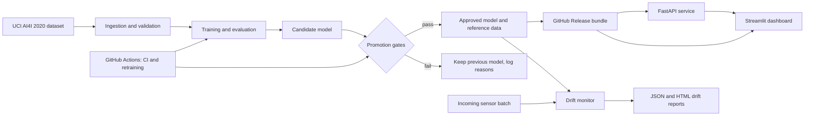

# Predictive Maintenance System: End-to-End Machine Learning and MLOps

<!-- Add the CI badge only after the workflow is green on GitHub:
[](https://github.com/YOUR-USER/predictive-maintenance-mlops/actions/workflows/ci.yml)
-->

A reproducible machine learning project that estimates the **probability of industrial equipment
failure** from sensor readings, serves it through a validated REST API and an interactive
dashboard, monitors incoming data for drift, and retrains models through GitHub Actions with
**gated, reversible promotion**. Built with free and open-source tools.

> **Honest scope.** The model uses the synthetic AI4I 2020 dataset, so results do not show
> performance on real equipment. It outputs a failure *probability score*. It does not predict the
> time remaining before a failure, and its output is a model estimate, never a confirmed failure.

## Business problem
Unplanned equipment downtime is costly, while unnecessary maintenance wastes time and parts.
A model that ranks machines by failure risk can help prioritise inspections. This project focuses
on doing that *responsibly*: leakage-free training, honest evaluation, input validation, drift
monitoring, and a safe path for updating the model. It makes no claims about real-world savings.

## Key features
- Data download, schema/quality validation and EDA for the AI4I 2020 dataset
- Leakage guard (failure-mode flags and identifiers removed), preprocessing fitted on training data only
- Logistic Regression baseline vs Random Forest, class-weighted, selected on **validation** PR-AUC
- Decision threshold chosen on validation data; test set evaluated once, at the end
- FastAPI service: `/health`, `/model-info`, `/predict`, `/monitor`, `/metrics`, with Pydantic validation, JSON logs and `/docs`
- Streamlit dashboard: prediction, distributions, metrics, confusion matrix, feature importance, drift checks, labelled simulated stream, report downloads
- Data-drift monitoring (KS test, chi-square, PSI) with configurable alert thresholds and JSON/HTML reports
- CI (lint, format, tests) and scheduled retraining with promotion gates, archive and rollback
- Render deployment configuration (free tier), Dockerfile for the API

## Architecture


## Technology stack
Python · pandas · NumPy · SciPy · scikit-learn · Matplotlib · Plotly · FastAPI · Pydantic ·
Uvicorn · Streamlit · pytest · Ruff · Git/GitHub Actions · Render · Docker.
Evidently is an *optional* extra (`requirements-extras.txt`); the core drift checks use SciPy so
they stay lightweight and testable. Model versioning uses metadata files, hashes and GitHub
Releases (no MLflow server).

## Dataset
**AI4I 2020 Predictive Maintenance Dataset**, UCI Machine Learning Repository
([link](https://archive.ics.uci.edu/dataset/601/ai4i)), licensed **CC BY 4.0**.
Attribution: Matzka, S. (2020). *AI4I 2020 Predictive Maintenance Dataset*. UCI Machine Learning
Repository. See the dataset page for the official citation.

- The data is **synthetic**, generated to resemble real predictive-maintenance data.
- Features used: air temperature, process temperature, rotational speed, torque, tool wear, product type. Target: `Machine failure`.
- `UDI`, `Product ID` and the failure-mode flags `TWF`, `HDF`, `PWF`, `OSF`, `RNF` are **removed**, because the flags define the target (leakage).
- The dataset has no real timestamp stream. The sensor stream used for drift demos is a **reproducible simulation**; its timestamps are simulated, never original measurements.

## Installation
Requires Python 3.10+ and Git.
```bash
git clone https://github.com/YOUR-USER/predictive-maintenance-mlops.git
cd predictive-maintenance-mlops
python -m venv .venv
source .venv/bin/activate          # Windows PowerShell: .venv\Scripts\Activate.ps1
pip install -r requirements-dev.txt
```

## Run locally
```bash
python scripts/download_data.py    # download and validate the dataset
python scripts/run_eda.py          # EDA summary and charts in reports/
python -m src.train                # train, compare, select, evaluate, save to models/
uvicorn app.api:app --reload       # API at http://localhost:8000/docs
streamlit run app/dashboard.py     # dashboard at http://localhost:8501
python scripts/simulate_sensor_stream.py   # simulated stream with drift alerts
```
`make train`, `make api`, `make dashboard`, `make simulate` do the same where `make` is available.
Run all commands from the repository root.

## Model training
`python -m src.train` validates the data, makes stratified train/validation/test splits (seed in
`configs/model_config.yaml`), fits both models on the training set, picks the decision threshold
per model on validation data (maximum F1), selects the final model by validation PR-AUC, and
evaluates the test set once. It writes `models/model.joblib`, `models/metadata.json` (version,
seed, library versions, data and model hashes, metrics) and `models/reference.csv` (the training
inputs, used as the drift reference), plus plots and `evaluation.json` in `reports/`.
Class imbalance is handled with class weights. Because of this, the output is a **risk score,
not a calibrated probability**.

## Testing
```bash
pytest                 # full test suite
make ci                # ruff lint + format check + tests (what CI runs)
```
| Requirement | Where it is tested |
|---|---|
| Missing/invalid sensor values, data validation | `tests/test_data_validation.py`, `tests/test_predictions.py`, `tests/test_api.py` |
| Target-leakage prevention | `tests/test_data_validation.py`, `tests/test_training.py` |
| Training on a small dataset, reproducibility | `tests/test_training.py` |
| Model loading and inference, response schema | `tests/test_predictions.py`, `tests/test_api.py` |
| API endpoints | `tests/test_api.py` |
| Drift: normal vs shifted data, simulation | `tests/test_drift.py` |
| Promotion, rejection, rollback, bundles | `tests/test_model_promotion.py` |
Most tests use small **synthetic** frames shaped like the dataset, so they run in seconds without a download.

## API
Interactive docs at `/docs` (OpenAPI at `/openapi.json`).

| Method | Path | Purpose |
|---|---|---|
| GET | `/health` | liveness; `status` is `ok` or `degraded` (no model loaded) |
| GET | `/model-info` | version, threshold, schema, validation/test metrics, hashes |
| POST | `/predict` | failure probability, risk category, version, timestamp |
| POST | `/monitor` | drift check of a batch (30 to 5000 readings) vs the training reference |
| GET | `/metrics` | uptime, request counts, latency, prediction and drift-check counts (no payloads) |

Errors share one format: `{"error": {"code", "message", "details"}}`; invalid input returns 422 and
a missing model returns 503. Risk bands default to 0.30 (medium) and 0.60 (high), configurable in
`configs/model_config.yaml` or with `RISK_THRESHOLD_MEDIUM` / `RISK_THRESHOLD_HIGH`.

```bash
curl -X POST http://localhost:8000/predict -H "Content-Type: application/json" -d '{
  "air_temperature_k": 300.1, "process_temperature_k": 310.2,
  "rotational_speed_rpm": 1500, "torque_nm": 40.0,
  "tool_wear_min": 100, "product_type": "M"}'
```
Response shape (values are illustrative and depend on your trained model):
```json
{
  "failure_probability": 0.05,
  "risk_category": "low",
  "predicted_failure": false,
  "decision_threshold": 0.5,
  "model_version": "20260101-030000",
  "prediction_timestamp": "2026-01-01T12:00:00+00:00",
  "disclaimer": "Model estimate only. This is not a confirmed equipment failure."
}
```
`POST /monitor` takes `{"readings": [ ...at least 30 objects shaped like the /predict request... ]}`
and returns per-feature test results, `drifted_features`, `alert_level` (`none`/`warning`/`alert`),
the model version and a UTC timestamp.

## Dashboard
Run `streamlit run app/dashboard.py`. Tabs: **Overview**; **Predict** (form with valid ranges,
gauge, risk category, reset button); **Data explorer**; **Model performance** (validation vs test
metrics, confusion matrix, permutation importance, metadata download); **Monitoring** (upload a CSV
for a drift check with JSON/HTML report downloads, plus a clearly labelled *simulated* stream).
The sidebar switches between the local model and the FastAPI service.

## Drift monitoring
- Reference data = the training split saved with each model (`models/reference.csv`).
- Numeric features: two-sample KS test (PSI reported too). Categorical: chi-square. A feature
  drifts at p < 0.05. The batch alerts when at least 30% of features drift. Batches under 30 rows are rejected.
- Simulation: `python scripts/simulate_sensor_stream.py --batches 12 --drift-start 6 --strength 2.0 --seed 42`
  resamples the reference data and injects a progressive shift from the chosen batch on.
- **Data drift is not concept drift.** A change in input distributions does not mean accuracy dropped.
  Measuring accuracy needs reliable ground-truth failure labels, which a live deployment may not have.

## GitHub Actions
- **CI** (`ci.yml`, every push and pull request): Ruff lint and format check, full pytest run, and a non-blocking real-dataset schema check.
- **Retraining** (`retrain.yml`, weekly schedule plus manual run): fetch the approved model, validate data, drift check, train a candidate, run tests, apply promotion gates, upload reports, and optionally publish to GitHub Releases.
- Least-privilege permissions (read-only; only the publish job can write), concurrency control, no secrets, no commits, no trigger loops. Actions are pinned to version tags with Dependabot updates.
- Scheduled runs use UTC, can be delayed, and are paused by GitHub after 60 days of repository inactivity. Manual retraining: Actions > "Scheduled retraining" > Run workflow, or see `docs/model_lifecycle.md`.

## Model versioning and promotion
A candidate replaces the approved model only if it passes: artifact integrity, passing tests, input
schema match, API compatibility, minimum validation PR-AUC and recall (`configs/model_config.yaml`),
and no worse validation PR-AUC than the approved model. Decisions use validation data only.
Failures keep the previous model and are logged with reasons in `model_registry/promotion_log.jsonl`.
Previous models are archived, and `python -m src.promote_model rollback --version <ver>` restores one.
Details and limitations: [`docs/model_lifecycle.md`](docs/model_lifecycle.md).
**Automatic redeployment is not implemented**: a deployed service picks up a published model the next time it starts.

## Deployment on Render (free tier)
`render.yaml` defines an API service and a dashboard service. Free services sleep after 15 minutes
idle (cold start about a minute), have a temporary filesystem, and 512 MB RAM, so the model is
fetched from a GitHub Release on every start and the dashboard may be memory-constrained.
Full steps, environment variables and troubleshooting: [`docs/deployment_render.md`](docs/deployment_render.md).

## Evaluation results
Generated from `models/metadata.json` by `make results` (no numbers are typed by hand).

<!-- RESULTS:START -->
Model version `20261010-054930` (trained 2026-10-10, seed 42, selected: **random_forest**).

| Model / split | Precision | Recall | F1 | PR-AUC | ROC-AUC | Threshold |
|---|---|---|---|---|---|---|
| logistic_regression (validation) | 0.492 | 0.556 | 0.522 | 0.498 | 0.923 | 0.900 |
| random_forest (validation) | 0.878 | 0.796 | 0.835 | 0.835 | 0.971 | 0.347 |
| **random_forest (test, final)** | 0.846 | 0.809 | 0.827 | 0.850 | 0.969 | 0.347 |

Test set: 2000 rows, 68 failures. Confusion matrix (TN/FP/FN/TP): 1922 / 10 / 13 / 55.
The model was chosen on validation PR-AUC; the test set was used once afterwards. With few failures in the test set these figures are noisy. The data is synthetic.
<!-- RESULTS:END -->

## Screenshots
Placeholders until real screenshots are added (see `docs/images/README.md`):
`docs/images/dashboard-predict.png` · `dashboard-performance.png` · `dashboard-drift.png` · `api-docs.png` · `actions-ci.png`

## Live demo
- Dashboard: _placeholder, add after verifying deployment_
- API: _placeholder, add after verifying deployment_
- API docs: _placeholder_ (`/docs` on the API URL)

## Limitations and future improvements
**Limitations**
- Synthetic data: no claim about real equipment. Few failures, so test metrics are noisy.
- Probability scores are not calibrated (class weights shift them).
- No time-to-failure or true time-series modelling; the stream is simulated.
- Drift tests are univariate; large batches flag tiny shifts, multiple tests inflate false alarms.
- Permutation importance describes the model, not causes.
- Promotion compares stored validation metrics, which is fair only when data and seed (hence the split) match; metadata is trusted from the workflow.
- Free hosting: cold starts, temporary disk, limited memory, no automatic redeploy.

**Future work**: probability calibration; real timestamped data and sequence features; multivariate and label-based (concept drift) monitoring; experiment tracking with MLflow; persistent monitoring storage; authentication and rate limiting; Render deploy hooks after publishing.

## Skills demonstrated
Leakage-aware ML pipeline design · imbalanced classification and metric choice (PR-AUC, recall) ·
honest train/validation/test discipline · reproducibility (seeds, hashes, metadata) · REST API design
and validation · dashboards · data and concept drift monitoring · testing (pytest) · CI/CD with
GitHub Actions · safe model promotion and rollback · free-tier cloud deployment trade-offs · technical documentation.

## Repository
Suggested description: *End-to-end predictive maintenance: scikit-learn failure model, FastAPI,
Streamlit, drift monitoring and gated retraining with GitHub Actions (AI4I 2020 synthetic data).*
Suggested topics: `predictive-maintenance`, `machine-learning`, `mlops`, `fastapi`, `streamlit`,
`scikit-learn`, `github-actions`, `data-drift`, `drift-detection`, `python`, `render`.

## License and attribution
Code: MIT (see `LICENSE`). Dataset: CC BY 4.0, attribution above. Contributions: see `CONTRIBUTING.md`.
"# predictive-maintenance-mlops" 
